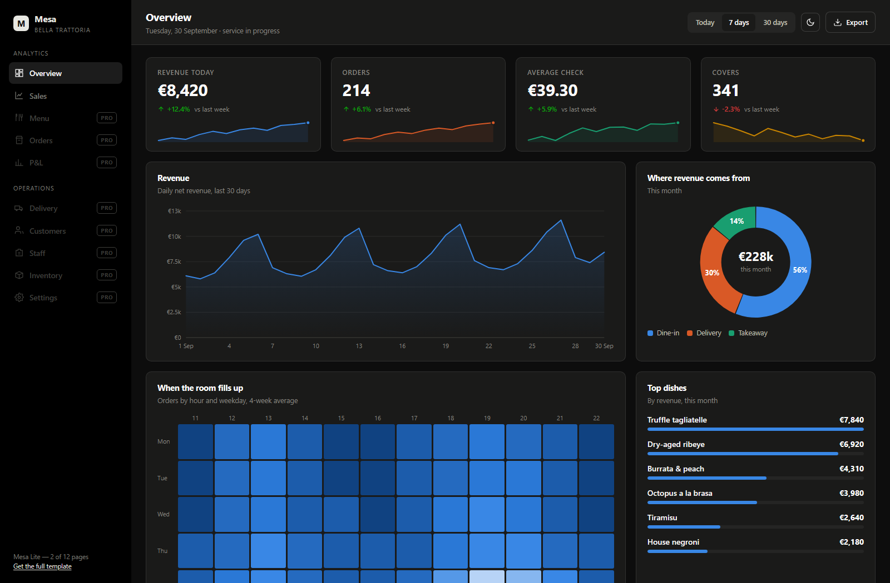
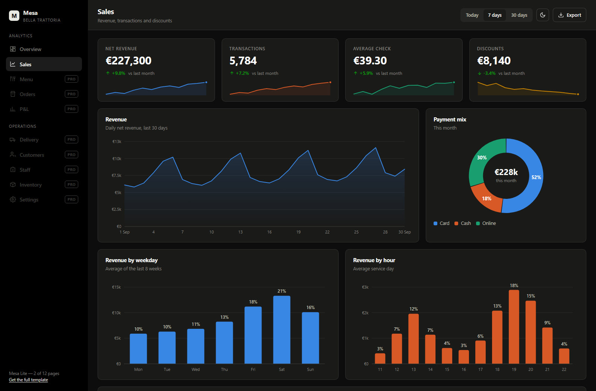

# Mesa Lite — restaurant analytics dashboard, zero dependencies

A dashboard template for restaurants, cafés and bars. Open `index.html` and it runs — no npm install, no bundler, no CDN, nothing that phones home.

The charts are not Chart.js. They are plain SVG, written from scratch, in one 25 KB file.



**[Live demo](https://Anatolii198.github.io/mesa-lite/)** · dark and light · works offline

---

## What's in here

Two full pages plus the two small ones that usually get skipped:

| Page | What it shows |
|---|---|
| `index.html` | Overview — KPI tiles, revenue, weekday × hour heatmap, top dishes, channel split, average check, live order feed |
| `sales.html` | Sales — revenue, payment mix, gross profit, margin by category, channel × payment, month-on-month |
| `login.html` | Sign-in |
| `404.html` | Not found |

Eight chart types, all hand-written:

`line / area` · `vertical bars (grouped and stacked)` · `horizontal stacked bars` · `donut with share labels` · `sparklines` · `ranked bar list` · `trend rows` · `weekday × hour heatmap`

Every chart has a hover tooltip and redraws on resize and on theme switch.



---

## Quick start

```bash
git clone https://github.com/Anatolii198/mesa-lite.git
cd mesa-lite
```

Then open `index.html` in a browser. That's the whole setup.

If your browser blocks local files, serve the folder over HTTP:

```bash
python -m http.server 8000
```

---

## Your own numbers

Every figure lives in `js/data.js` inside a single `DATA` object. Replace the values, keep the shape, and both pages update. Nothing is hard-coded in the markup.

```js
const DATA = {
  currency: '€',
  kpi: {
    revenue: { value: 8420, delta: 12.4, spark: [6100, 6480, /* … */] },
    // …
  },
  revenue30: { labels: ['1 Sep', '2 Sep', /* … */], values: [6800, 7250, /* … */] },
  // …
};
```

## Drawing a chart

Every chart takes a CSS selector and a config object:

```js
Mesa.line('#chart-revenue', {
  labels: DATA.revenue30.labels,
  series: [{ name: 'Revenue', color: '--s1', values: DATA.revenue30.values }],
  currency: '€',
  height: 268
});

Mesa.bars('#chart-channels', {
  labels: DATA.channels.labels,
  series: DATA.channels.series,
  stacked: true,
  currency: '€'
});

Mesa.donut('#chart-split', { items: DATA.channelSplit, currency: '€' });
```

`color` takes a CSS custom property name (`--s1` … `--s4`), so series colours come from the stylesheet and both themes stay correct. The palette is checked for deuteranopia, protanopia and tritanopia — adjacent categorical colours stay distinguishable, and status colours always ship with a label rather than colour alone.

## Theming

Design tokens sit at the top of `css/style.css`. The pages ship dark with no flash of white; the toggle switches to light and remembers the choice in `localStorage`. Charts re-read their colours on switch — it is not a CSS filter inversion.

---

## The full template

This repository is the free cut. The commercial version adds ten more pages and three more chart types:

| | Mesa Lite | Mesa |
|---|---|---|
| Pages | 2 + sign-in + 404 | 12 + sign-in + 404 |
| Chart types | 8 | 11 |
| Menu, Orders, P&L, Delivery, Customers, Staff, Inventory, Settings | — | ✓ |
| P&L waterfall, service timeline, menu-engineering scatter | — | ✓ |
| CSV export of any page | — | ✓ |
| README with the full chart API | — | ✓ |

**[Get Mesa — $29](https://payhip.com/b/C8O71)** · [full demo, all 12 pages](https://mesa-dashboard-demo.netlify.app)

Need it filled with your own numbers? Swapping `data.js` is straightforward, but a one-off load of your data, a converter from your POS or spreadsheet exports, or a live connection to a system with an API is a paid service, quoted per job — ask through the store.

---

## Notes

The figures here are realistic demo data for a fictional restaurant; no real business numbers are included. The date-range buttons and the sign-in form are deliberate placeholders — point them at your own backend and the rest of the page already works.

Browser support: current Chrome, Edge, Firefox and Safari, desktop and mobile. Responsive from 360 px up.

## License

MIT — see [LICENSE](LICENSE). Use it in personal and commercial projects.
